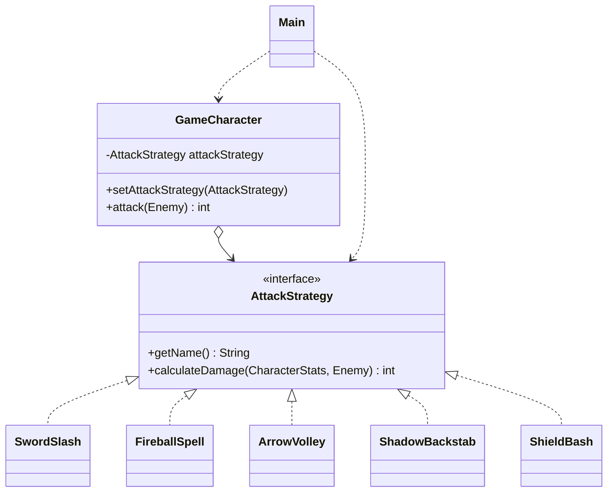

[Uploading README.md…]()
# Dragon Slayer - Strategy Pattern (Assignment #5)

**Course:** Software Design Patterns
**Pattern:** Strategy (behavioral)
**Language:** Java

## Theme

A game character, **Aria the Versatile**, fights an **Ancient Dragon**.
Aria can change her combat style in the middle of the fight. Each combat style is one interchangeable damage algorithm.

## Pattern Mapping

| Pattern component | Class | Role |
|---|---|---|
| Strategy Interface | `strategy.AttackStrategy` | Declares `getName()` and `calculateDamage(stats, target)` |
| Concrete Strategy 1 | `SwordSlash` | Strength-based, reduced by armor |
| Concrete Strategy 2 | `FireballSpell` | Intelligence-based, reduced by magic resistance |
| Concrete Strategy 3 | `ArrowVolley` | 3 arrows, each reduced by armor |
| Concrete Strategy 4 | `ShadowBackstab` | Dexterity-based, ignores all resistance |
| Concrete Strategy 5 | `ShieldBash` | Defense-based, reduced by armor (added last to prove extensibility) |
| Context | `model.GameCharacter` | Holds an `AttackStrategy`, delegates `attack()`, supports `setAttackStrategy()` at runtime |
| Client | `Main` | Creates the strategies, picks and switches them |

Supporting classes: `CharacterStats` (hero attributes), `Enemy` (the target), `DamageMath` (shared "minimum damage" rule).

## Structure

```
src/
  Main.java                      <- Client
  model/
    CharacterStats.java
    Enemy.java
    GameCharacter.java           <- Context
  strategy/
    AttackStrategy.java          <- Strategy interface
    DamageMath.java
    SwordSlash.java
    FireballSpell.java
    ArrowVolley.java
    ShadowBackstab.java
    ShieldBash.java
```

## UML



## How to Compile and Run

From the project root:

```bash
mkdir out
javac -d out $(find src -name "*.java")
java -cp out Main
```

In IntelliJ: mark `src` as *Sources Root* and run `Main`.

### Expected output

```
Round 1: Aria the Versatile uses Sword Slash -> 42 damage. Ancient Dragon HP: 358
Round 2: Aria the Versatile uses Fireball Spell -> 85 damage. Ancient Dragon HP: 273
Round 3: Aria the Versatile uses Arrow Volley -> 96 damage. Ancient Dragon HP: 177
Round 4: Aria the Versatile uses Shadow Backstab -> 88 damage. Ancient Dragon HP: 89
Round 5: Aria the Versatile uses Shield Bash -> 51 damage. Ancient Dragon HP: 38
Round 6: Aria the Versatile uses Sword Slash -> 42 damage. Ancient Dragon HP: 0
```

## Clean Code Principles Applied

1. **Polymorphism instead of conditionals.**
   `GameCharacter.attack()` has no `if` or `switch` on the attack type. A single call, `attackStrategy.calculateDamage(...)`, runs the right algorithm. Without the pattern, the Context would need `if (style == FIRE) ... else if (style == SWORD) ...`, which grows with every new style.

2. **Meaningful, intention-revealing names.**
   `SwordSlash`, `FireballSpell`, `ArrowVolley`, `ShadowBackstab` and `ShieldBash` tell the reader what each class does. Method names such as `calculateDamage` and `afterResistance` describe their result. Constants like `ARROWS_PER_VOLLEY` replace magic numbers.

3. **Single Responsibility Principle.**
   Each strategy contains exactly one damage formula and nothing else. `Enemy` only tracks health and resistances, `CharacterStats` only stores attributes, and `GameCharacter` only manages the current strategy and delegates.

4. **Context stays algorithm-agnostic.**
   `GameCharacter` depends only on the `AttackStrategy` interface (Dependency Inversion). It never imports a concrete strategy, so it cannot know their internals.

5. **Open/Closed Principle - easy extensibility.**
   `ShieldBash` was added after the other four without editing any existing class. To add a new style, create one new class and give it to the client.

6. **DRY (Don't Repeat Yourself).**
   The "damage is never below 1" rule exists only in `DamageMath.afterResistance`, and four strategies reuse it.

7. **Small, readable functions and fail-fast input.**
   Every method is only a few lines long. `Objects.requireNonNull` rejects a missing strategy at the moment it is set, not later during a fight.

## How to Add a New Strategy

1. Create a class in `strategy/` that `implements AttackStrategy`.
2. Implement `getName()` and `calculateDamage(...)`.
3. In `Main`, add `new YourStrategy()` to the `battlePlan` list.

No other file changes.

## Defense Preparation (Short Q&A)

**What problem does Strategy solve?**
It lets you swap one algorithm for another at runtime without large conditional blocks, by putting each algorithm in its own class behind a common interface.

**Who selects the strategy?**
The Client (`Main`). The Context only stores and uses the strategy.

**Where is the runtime switch?**
`GameCharacter.setAttackStrategy(...)`, called every round in `Main`.

**Why is there no `if`/`switch` on strategy type?**
Because polymorphism does the selection. The only conditional left is `while (dragon.isAlive())`, which checks game state, not strategy type.

**Strategy vs. State?**
Strategy is chosen from outside by the client and strategies do not know each other. In State, the object's own state changes and transitions between states happen internally.

**Why an interface and not an abstract class?**
The strategies share no code or fields, only a contract. An interface gives the smallest, most flexible contract.
